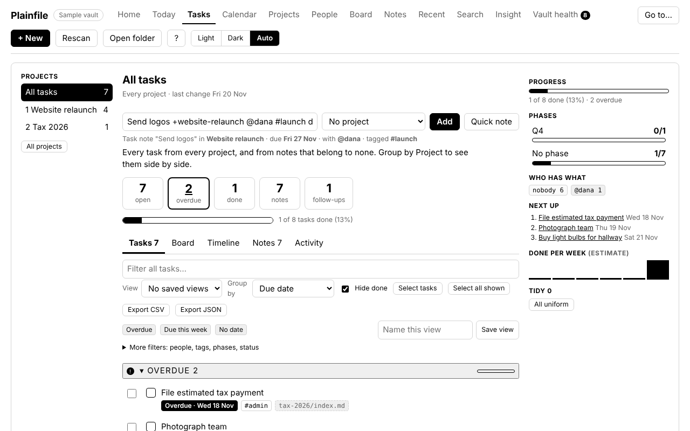
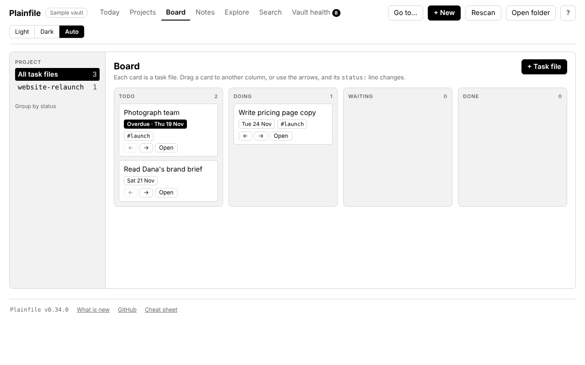
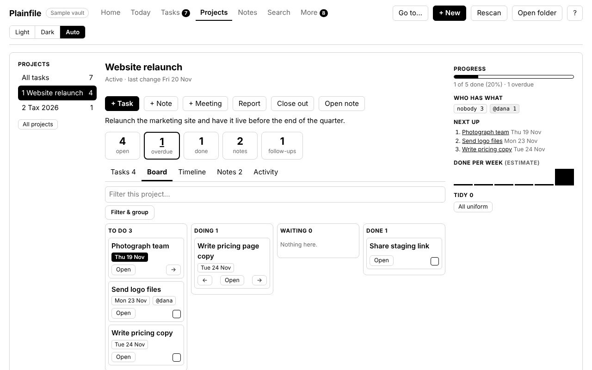
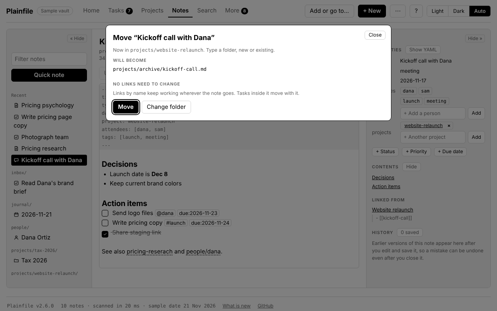
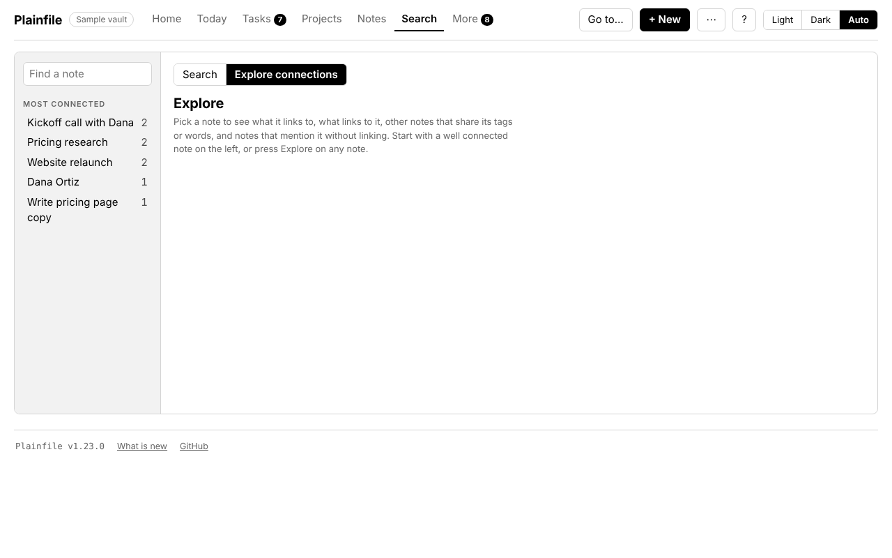

# Plainfile

**Working name.** Successor to Notebook.

<a href="https://www.buymeacoffee.com/adambeltz" target="_blank" rel="noopener noreferrer"></a>

**Live app: <https://adambeltz2.github.io/Plainfile/>** (open it in Chrome, Edge or Brave to use a
local folder, or connect Dropbox in any browser, including iPhone).

A productivity hub over a plain folder of markdown files. Tasks, notes, tags and
links live in ordinary `.md` files with frontmatter. The app reads them and
gives you one place to see everything. Nothing is stored anywhere else, so the
folder is the whole repository and works with any editor or sync tool.

## Get started

1. Open the **[live app](https://adambeltz2.github.io/Plainfile/)**. Choose **Open folder** (Chrome, Edge or Brave), **Connect Dropbox** (any browser, including iPhone), or **Try the sample vault**.
2. On **Home**, type a task in the box at the top: `Call Dana +Website @dana due:friday`. It becomes its own note.
3. Open **Tasks** to see everything across every project, **Notes** to write, and press **?** for the cheat sheet and quick keys.

Your folder stays plain markdown the whole time; delete the app and every file still opens anywhere.

## How it relates to SilverBullet and Obsidian

Plainfile is plainly inspired by tools like <a href="https://silverbullet.md/" target="_blank" rel="noopener noreferrer">SilverBullet</a> and <a href="https://obsidian.md/" target="_blank" rel="noopener noreferrer">Obsidian</a>: your notes are a folder of markdown files you own, linked with `[[wikilinks]]`, edited live. The approach differs in a few ways:

- **Tasks and projects are first-class, and still plain files.** A task can be an inline `- [ ]` line or its own note with a `status:`; projects are folders. Home, Tasks (with its Today view), the project hub and the weekly review are views over those files, not a second database.
- **It reads other people's conventions without rewriting them.** `due:`, `📅`, Dataview `[due:: …]`, `#tags` and `[[links]]` all work, and writes touch the smallest piece of text possible.
- **Nothing to install or run.** It is a static web page that opens a folder (or a Dropbox folder) directly in the browser. There is no server, database, account or plugin system, and the index is a cache you can delete.
- **It shows its work.** After every write you see the exact before and after lines; deleting goes to a trash; every save keeps history.
- **Black and white, on purpose.** State is shown with weight, borders and inversion, not color.

## What it looks like

Screenshots are of the built-in sample vault, regenerated with `npm run screenshots`.

| | |
|---|---|
| **Home**: a one-line capture bar, week bars and projects at the top, today, filing, waiting, the week |  |
| **Tasks**: every task from every project, one place to start the day (grouped by due date; or by project) |  |
| **Recent**: every note by when it last changed, grouped by day, with a filter |  |
| **Calendar**: tasks and dated notes by day, drag to reschedule |  |
| **Insight**: activity, this month, topics, people, health |  |
| **Today view** (the Tasks tab opens on it): everything late, due today or due this week, one-line quick add, a readout of the exact change on disk |  |
| **Quick add**: `Send logos +website-relaunch @dana #launch due:friday`, with a live preview |  |
| **Board**: task files in status columns |  |
| **Project hub**: tasks grouped and filtered, status column, tabs, bulk changes |  |
| **Project board**: the same tasks by status |  |
| **Notes**: a live editor with X-ray, a properties panel, history and focus mode |  |
| **Notes home**: pinned, modified today, recent and folders |  |
| **⋯ More menu**: move, rename, duplicate, pin, delete |  |
| **Move**: a preview of the links it fixes, then Undo |  |
| **Go to…**: the command palette |  |
| **Search**: operators, plus `modified:today` and other date chips |  |
| **Explore** (a switch inside Search): related notes and a neighbourhood graph |  |
| **Dark mode**: Light, Dark or Auto on every screen |  |
| **On a phone**: installable, works offline |  |

## Highlights

- **One list of tasks** from inline `- [ ]` lines and one-file-per-task notes, with Tasks (opens on Today; also All, Late, Upcoming, Waiting, Inbox and Follow-ups), a project hub, Board, Calendar and a weekly review.
- **A live editor** with `[[links]]`, `#tags`, `@people` and type-ahead; click a link to go there, or to create it.
- **Safe by design:** every write is the smallest edit, guarded by the file's modified time, with history, a trash, and a readout of the exact lines changed.
- **Yours:** plain files, no account or server; sync with whatever you already use. Export to Word, PDF, markdown, HTML, CSV and JSON.

## Documentation

- [Features](docs/FEATURES.md): everything it does, by area.
- [Task formats](docs/TASK-FORMATS.md): the task syntaxes it reads and writes.
- [Principles and interface design](docs/DESIGN.md): what the app will not do and why.
- [Connecting Dropbox](docs/DROPBOX.md): setup for your own app key.
- [CONTRIBUTING.md](CONTRIBUTING.md), [CHANGELOG.md](CHANGELOG.md), [BACKLOG.md](BACKLOG.md), and `CLAUDE.md` for the engineering conventions.

## Develop and run it locally

```bash
npm install
npm run build && npm run serve   # then open http://127.0.0.1:4173
npm test                         # unit tests
npm run test:e2e                 # browser tests, including a real folder
npm run screenshots              # regenerate docs/screenshots (needs the server running)
npm run plainfile -- today --vault sample-vault --today 2026-11-21
npm run plainfile -- check --vault sample-vault
npm run plainfile -- check --json --strict --vault sample-vault   # for CI: JSON report, exit 1 if a link is broken
npm run plainfile -- search "is:open tag:launch" --vault sample-vault
```

Commands: `today`, `tasks`, `search`, `backlinks`, `check`, `scan`, `done`, `undo`.
Task ids are `path:line`, as printed by `today` and `tasks`.

## License

MIT. See `LICENSE`.
