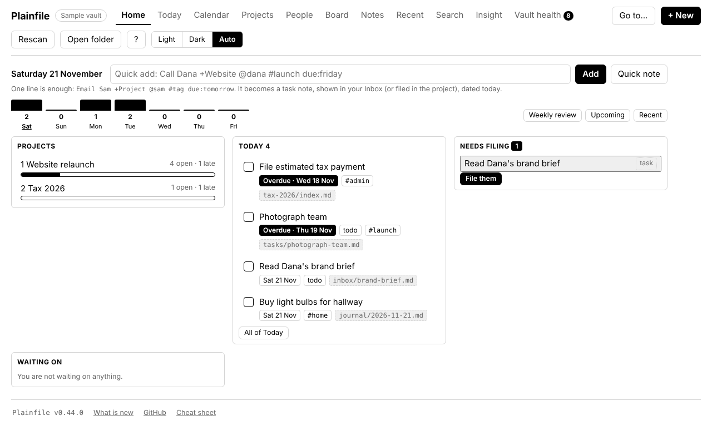
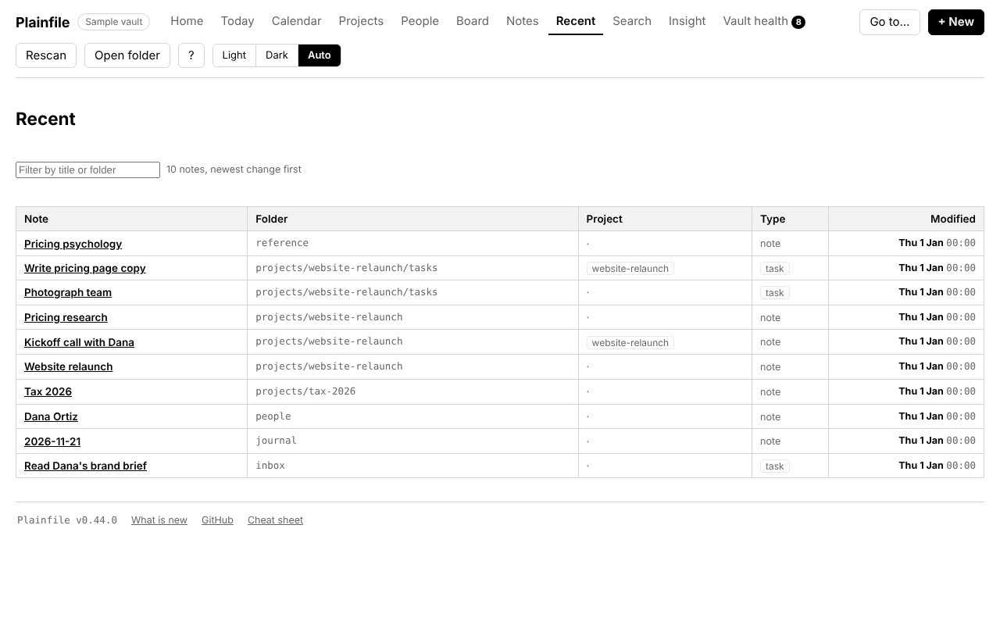
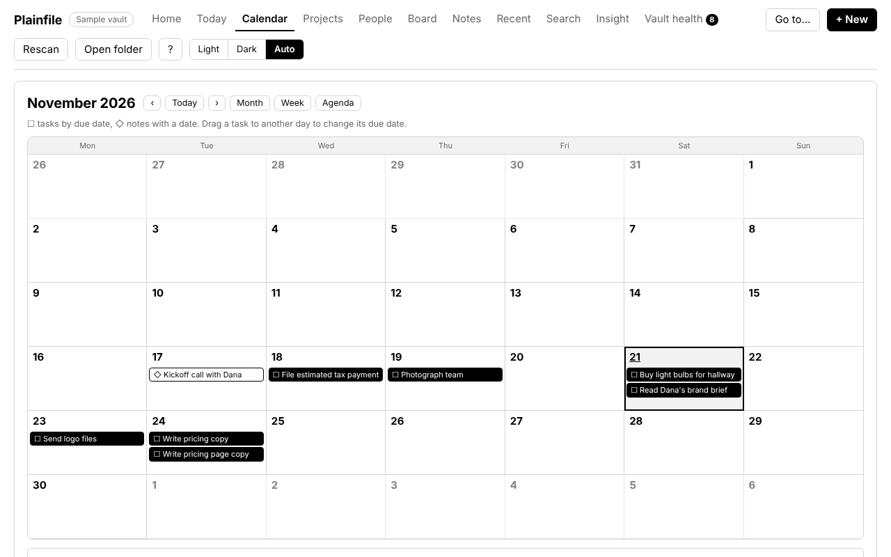
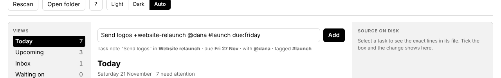
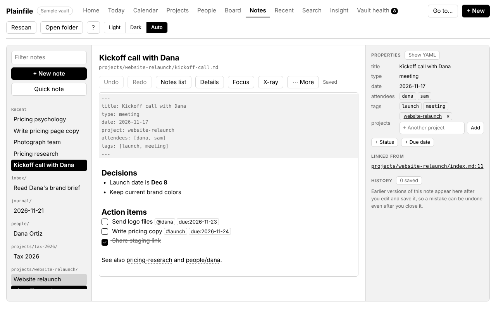
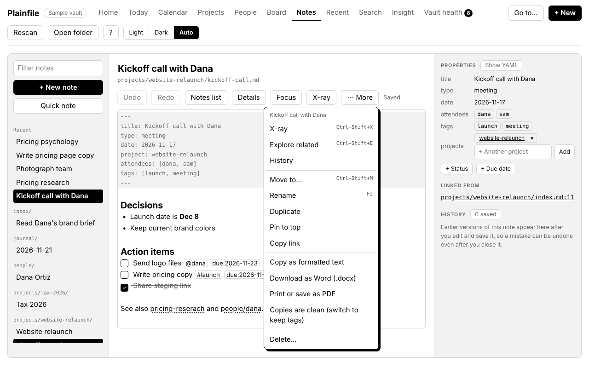
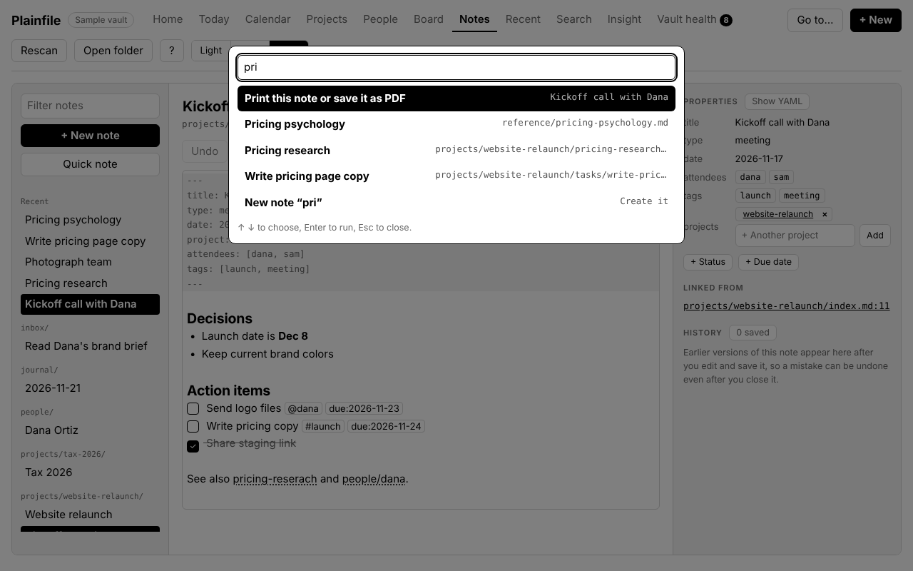

# Plainfile

**Working name.** Successor to Notebook.

<a href="https://www.buymeacoffee.com/adambeltz" target="_blank" rel="noopener noreferrer"></a>

**Live app: <https://adambeltz2.github.io/Simple-Productivity/>** (open it in Chrome, Edge or Brave to use a
local folder, or connect Dropbox in any browser, including iPhone).

A productivity hub over a plain folder of markdown files. Tasks, notes, tags and
links live in ordinary `.md` files with frontmatter. The app reads them and
gives you one place to see everything. Nothing is stored anywhere else, so the
folder is the whole repository and works with any editor or sync tool.

## What it looks like

Screenshots are of the built-in sample vault, regenerated with `npm run screenshots`.

| | |
|---|---|
| **Home**: a one-line capture bar, week bars and projects at the top, today, filing, waiting, the week |  |
| **Recent**: every note by when it last changed, grouped by day, with a filter |  |
| **Calendar**: tasks and dated notes by day, drag to reschedule |  |
| **Insight**: activity, this month, topics, people, health |  |
| **Today**: everything due or overdue, one-line quick add, a readout of the exact change on disk |  |
| **Quick add**: `Send logos +website-relaunch @dana #launch due:friday`, with a live preview |  |
| **Board**: task files in status columns |  |
| **Project hub**: tasks grouped and filtered, status column, tabs, bulk changes |  |
| **Project board**: the same tasks by status |  |
| **Notes**: a live editor with X-ray, a properties panel, history and focus mode |  |
| **Notes home**: pinned, modified today, recent and folders |  |
| **⋯ More menu**: move, rename, duplicate, pin, delete |  |
| **Move**: a preview of the links it fixes, then Undo |  |
| **Go to…**: the command palette |  |
| **Search**: operators, plus `modified:today` and other date chips |  |
| **Explore** (a switch inside Search): related notes and a neighbourhood graph |  |
| **Dark mode**: Light, Dark or Auto on every screen |  |
| **On a phone**: installable, works offline |  |

## Features

- **Insight:** an activity heatmap, this month at a glance, topics, people, folders and vault health, with a
  vault-wide tidy list for non-standard fields.
- **People:** everyone in your notes (from @mentions and people fields, joined by person notes), with their open
  tasks, what you are waiting on, meetings and notes.
- **Calendar:** month, week and agenda views of tasks and dated notes. Drag a task to another day to change its
  due date in its own file.
- **Share outside markdown:** copy a note (or a selection) as formatted text for Word, Docs or email, download it as
  a Word file, or print it to PDF, cleanly (no frontmatter or tags). A project **Report** builds a status snapshot
  you can copy, download or save as a note.
- **Home and the weekly review:** a landing screen (capture, today, what needs filing, what
  you are waiting on, the week ahead, project progress) and a four-step review that files, reschedules and plans
  with small guarded edits to your own notes.
- **Today:** open tasks that are late, due today or due this week, plus Upcoming, Inbox, Waiting on,
  All open, Follow-ups and Projects views. Ticking a box changes one character in the file and shows
  the exact before and after lines.
- **Every task is its own note** (`tasks/<title>.md`, or inside its project), so it has room for details,
  and it shows in Today, the Board and your Inbox.
- **One-line quick add:** `Call Dana +Website @dana #launch due:tomorrow`. Natural dates (`today`,
  `tomorrow`, `mon`, `next-week`, `+3d`), a preview before you save, and type-ahead for people, tags
  and projects, and `due:` day words. Every task gets a created date.
- **Projects:** a hub per project built for hundreds of tasks: a project rail, tabs (Tasks, Board, Timeline,
  Notes, Activity), grouping by due date, status, person, phase or tag, filter chips, a status column,
  bulk changes with a preview and Undo, saved views, and a sortable portfolio table. A project is a folder with an `index.md`; notes elsewhere
  belong to it when their `project:` names it. Notebook projects (`active`, `sortOrder`) still work.
- **Uniform fields without requiring them:** frontmatter is read tolerantly; a Tidy panel offers one-line
  fixes to the standard field names and values.
- **Notes:** click a link in a note to go to it (or to create it, if it does not exist yet); hide the list and details panes to use the whole window on a wide screen.
- **Notes:** reopens where you left off, or shows a home with pinned, modified-today and recent notes.
  One live editor where `- [ ] ` becomes a checkbox as you type. X-ray shows raw
  markdown, focus mode hides the noise, and a properties panel edits frontmatter. A button adds
  default frontmatter to a note that has none. Autosave, Undo and Redo, version history with restore,
  and delete to a trash you can restore from.
- **Move, duplicate, pin:** move a note to another folder with a preview of the links it fixes and an
  Undo, duplicate it, or pin it to the top. They live in a **⋯ More** menu on the note and in a
  right-click or long-press menu in the list.
- **Quick note:** one click or Alt+N makes a note titled with the date and time, ready to type; tag it later.
- **Go to… and quick keys:** Ctrl/Cmd+P finds a note by a few letters, creates one, or runs an action
  ("move kick"). F2 renames, Ctrl/Cmd+Shift+M moves, Ctrl/Cmd+Shift+X toggles X-ray.
- **Paste images:** paste a screenshot or drop an image into a note; it is saved in `_attachments/`, linked
  relative to the note and shown inline.
- **Type-ahead:** `[[` links, `#` tags, `@` people, `due:` days and frontmatter values while you type.
- **Projects on any note:** add a note to one or more projects from its properties, and it shows on
  each project's dashboard with its tasks.
- **Search:** words plus `tag:`, `folder:`, `type:`, `is:open`, `due:`, `@person`, `modified:` and
  `created:`, with "Modified today" chips and a recent-notes list.
- **Explore** (under the Search tab, switch at the top): related notes (shared tags, links, project, similar text) and a graph.
- **Templates:** markdown files in `.plainfile/templates/`, with questions, date variables and a
  cursor position. Built in: Note, Task, Project, Meeting (people and project), Journal, Person.
- **Rename and links:** renaming a note rewrites every link to it, with a preview. Renames made
  outside the app are detected and offered as a one-click fix.
- **Vault health:** broken links, duplicates, orphans and unused attachments, with one-click fixes.
  It never blocks your work.
- **Fast reopening:** a saved copy of the parsed notes (only a cache) means a big folder, local or Dropbox, reads
  only what changed. Dropbox rescans ask just for the changes.
- **Big folders:** a progress bar with counts and a Cancel button while a large folder is read.
  Files that cannot be read are skipped and listed, so one bad file never blocks the folder.
- **Dropbox:** open a vault stored in Dropbox from any browser. Files go only between your browser and
  Dropbox, sign-in uses PKCE with no server, and writes are checked against Dropbox revisions.
- **Install it:** works as an app on desktop and phone, and opens offline after the first visit.

Opening a local folder needs Chrome, Edge, Brave or Opera (desktop or Android). In any other browser,
including Safari and iPhone, **connect Dropbox** instead (see below), or try the sample vault. The app has no server and no accounts, and nothing leaves your
device.

The previous app, Notebook, is preserved at commit
[`76ac8ba`](https://github.com/adambeltz2/Simple-Productivity/tree/76ac8bab2b96dbd24463fea5f825702dc1c3a441).
Design mockups are in [`docs/mockups.html`](docs/mockups.html).

## Principles

- **Files are the source of truth.** The index is a cache and can always be rebuilt.
- **Tolerant reading.** Any markdown file works, with or without frontmatter.
  Obsidian Tasks and Dataview date styles are understood.
- **Minimal writing.** The app edits the smallest piece of text it can: one
  checkbox character, one `status:` value. It never reformats a file, and never
  touches a file you did not change. Line endings are preserved.
- **Safe writes.** A write is refused if the file changed on disk since it was read.
- **Structure is opt-in.** Plain notes work. Frontmatter, types and templates
  unlock more, but nothing is required.

## What exists so far

| Piece | File |
|---|---|
| Storage interface (browser, server and in-memory all implement it) | `src/storage.ts` |
| Parser: frontmatter, inline tasks, tags, links, embeds | `src/parse.ts` |
| Index: incremental scan, link resolution, back-links, rename detection | `src/index.ts` |
| Today view and search operators | `src/query.ts` |
| Safe checkbox and status write-back | `src/writeback.ts` |
| Vault health checks | `src/health.ts` |
| Folder storage and CLI | `src/node-storage.ts`, `src/cli.ts` |
| Browser folder access (File System Access API) | `src/fsa-storage.ts`, `web/handle-store.ts` |
| Browser app: shell and screens (Today, Projects, Notes, Search, Health, New menu) | `web/main.ts`, `web/today.ts`, `web/project.ts`, `web/notes.ts`, `web/search.ts`, `web/health.ts`, `web/newmenu.ts` |
| Live editor | `web/editor.ts` |
| Board and Rename screens | `web/board.ts`, `web/rename.ts`, `src/rename.ts` |
| Dropbox storage and sign-in | `src/dropbox-storage.ts`, `src/dropbox-auth.ts`, `web/cloud.ts` |
| Move and duplicate notes | `src/move.ts`, `web/move.ts`, `web/menu.ts`, `web/palette.ts` |
| Templates, quick add and its one-line parser, link fixes, frontmatter edits | `src/templates.ts`, `src/capture.ts`, `src/quickline.ts`, `src/fixes.ts`, `src/frontmatter.ts` |
| Projects and the project dashboard | `src/projects.ts` |

Next: a small local server as a fallback for browsers that cannot open a folder.

**Install it:** in Chrome, Edge or Safari use the install button in the address bar (or
"Add to Home Screen" on a phone). It then opens in its own window, and the app itself
opens offline after the first visit.

## Try it

```bash
npm install
npm run build && npm run serve   # then open http://127.0.0.1:4173
npm test                         # unit tests
npm run test:e2e                 # browser tests, including a real folder
npm run screenshots              # regenerate docs/screenshots (needs the server running)
npm run plainfile -- today --vault sample-vault --today 2026-11-21
npm run plainfile -- check --vault sample-vault
npm run plainfile -- search "is:open tag:launch" --vault sample-vault
```

Commands: `today`, `tasks`, `search`, `backlinks`, `check`, `scan`, `done`, `undo`.
Task ids are `path:line`, as printed by `today` and `tasks`.

## Connecting Dropbox

Choose **Connect Dropbox** on the first screen, optionally type a folder such as `/Notes`, and sign in.
Plainfile uses its own Dropbox app by default. The app key in `web/cloud.ts` is public by design: sign-in
uses PKCE, so there is no secret.

To use your own Dropbox app instead (for a private copy, or if the shared app reaches its user limit):

1. At [dropbox.com/developers/apps](https://www.dropbox.com/developers/apps) create an app: **Scoped access**,
   then **App folder** (safest) or **Full Dropbox**.
2. On the **Permissions** tab tick `files.metadata.read`, `files.metadata.write`, `files.content.read`
   and `files.content.write`, and submit.
3. On **Settings**, add the address of the page that serves Plainfile under **Redirect URIs**.
4. Paste the app key under **Use my own Dropbox app**, or set the `DROPBOX_APP_KEY` repository variable
   to build it in.

## Task formats

```markdown
- [ ] Send logo files @dana due:2026-11-23 #launch      inline, in any note
```

```markdown
---
title: Write pricing page copy
status: doing
due: 2026-11-24
---
```

A note is a task file when it has `status` and lives in a `tasks/` folder or has
`type: task`.

## Interface design

- Black and white only. A Light, Dark or Auto control on every screen; Auto follows your device.
- Typing `- [ ] ` converts to a checkbox as you type, and a typed `*` is saved as `-`.
  Inline formatting renders when you leave the line.
- X-ray shows any note as raw markdown.
- The ? button opens a cheat sheet of the syntax, with your own tags and frontmatter keys.

## Project docs

- `CLAUDE.md`: engineering conventions and product rules, including keeping this README current.
- `CHANGELOG.md`: what shipped, by version.
- `BACKLOG.md`: deferred features, bugs and debt.

## License

MIT. See `LICENSE`.
