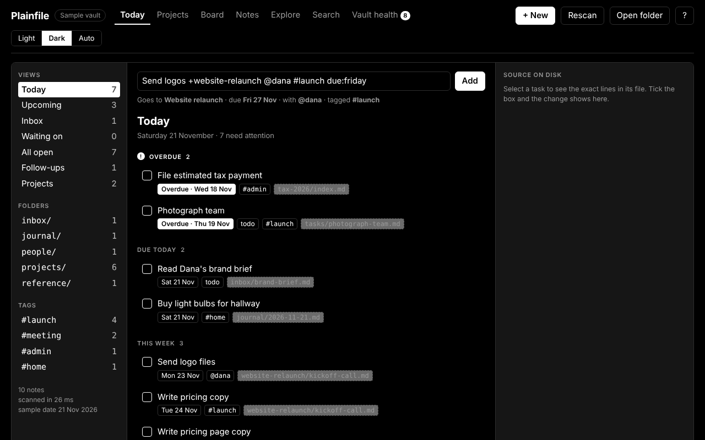
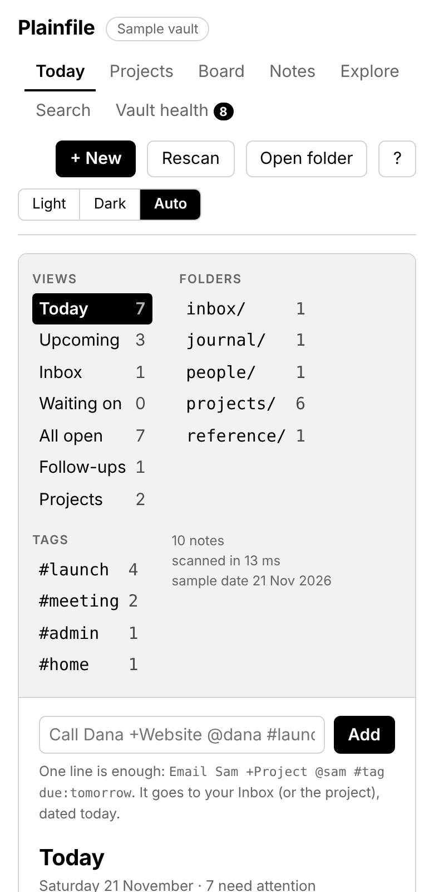

# Plainfile

**Working name.** Successor to Notebook.

<a href="https://www.buymeacoffee.com/adambeltz" target="_blank" rel="noopener noreferrer"></a>

A productivity hub over a plain folder of markdown files. Tasks, notes, tags and
links live in ordinary `.md` files with frontmatter. The app reads them and
gives you one place to see everything. Nothing is stored anywhere else, so the
folder is the whole repository and works with any editor or sync tool.

## What it looks like

Screenshots are of the built-in sample vault, regenerated with `npm run screenshots`.

| | |
|---|---|
| **Today**: everything due or overdue, one-line quick add, a readout of the exact change on disk |  |
| **Quick add**: `Send logos +website-relaunch @dana #launch due:friday`, with a live preview |  |
| **Projects**: a dashboard per project, with open tasks, notes, people, tags and follow-ups |  |
| **Board**: task files in status columns |  |
| **Notes**: a live editor with X-ray, a properties panel, history and focus mode |  |
| **Search**: operators, plus `modified:today` and other date chips |  |
| **Explore**: related notes and a neighbourhood graph |  |
| **Dark mode**: Light, Dark or Auto on every screen |  |
| **On a phone**: installable, works offline |  |

## Features

- **Today:** open tasks that are late, due today or due this week, plus Upcoming, Inbox, Waiting on,
  All open, Follow-ups and Projects views. Ticking a box changes one character in the file and shows
  the exact before and after lines.
- **One-line quick add:** `Call Dana +Website @dana #launch due:tomorrow`. Natural dates (`today`,
  `tomorrow`, `mon`, `next-week`, `+3d`), a preview before you save, and type-ahead for people, tags
  and projects. Every task gets a created date.
- **Projects:** a dashboard per project with progress, overdue count, open tasks you can tick,
  notes, follow-ups, people and tags. A project is a folder with an `index.md`; notes elsewhere
  belong to it when their `project:` names it. Notebook projects (`active`, `sortOrder`) still work.
- **Notes:** one live editor where `- [ ] ` becomes a checkbox as you type. X-ray shows raw
  markdown, focus mode hides the noise, and a properties panel edits frontmatter. A button adds
  default frontmatter to a note that has none. Autosave, Undo and Redo, version history with restore,
  and delete to a trash you can restore from.
- **Type-ahead:** `[[` links, `#` tags, `@` people and frontmatter values while you type.
- **Search:** words plus `tag:`, `folder:`, `type:`, `is:open`, `due:`, `@person`, `modified:` and
  `created:`, with "Modified today" chips and a recent-notes list.
- **Explore:** related notes (shared tags, links, project, similar text) and a graph.
- **Templates:** markdown files in `.plainfile/templates/`, with questions, date variables and a
  cursor position. Built in: Note, Task, Project, Meeting (people and project), Journal, Person.
- **Rename and links:** renaming a note rewrites every link to it, with a preview. Renames made
  outside the app are detected and offered as a one-click fix.
- **Vault health:** broken links, duplicates, orphans and unused attachments, with one-click fixes.
  It never blocks your work.
- **Big folders:** a progress bar with counts and a Cancel button while a large folder is read.
- **Install it:** works as an app on desktop and phone, and opens offline after the first visit.

Opening a folder directly needs Chrome, Edge, Brave or Opera on desktop. Safari, Firefox and phones
can try the sample vault for now. The app has no server and no accounts, and nothing leaves your
device.

The previous app, Notebook, is preserved at commit
[`76ac8ba`](https://github.com/adambeltz2/Simple-Productivity/tree/76ac8bab2b96dbd24463fea5f825702dc1c3a441).
Design mockups are in [`docs/mockups.html`](docs/mockups.html).

## Principles

- **Files are the source of truth.** The index is a cache and can always be rebuilt.
- **Tolerant reading.** Any markdown file works, with or without frontmatter.
  Obsidian Tasks and Dataview date styles are understood.
- **Minimal writing.** The app edits the smallest piece of text it can: one
  checkbox character, one `status:` value. It never reformats a file, and never
  touches a file you did not change. Line endings are preserved.
- **Safe writes.** A write is refused if the file changed on disk since it was read.
- **Structure is opt-in.** Plain notes work. Frontmatter, types and templates
  unlock more, but nothing is required.

## What exists so far

| Piece | File |
|---|---|
| Storage interface (browser, server and in-memory all implement it) | `src/storage.ts` |
| Parser: frontmatter, inline tasks, tags, links, embeds | `src/parse.ts` |
| Index: incremental scan, link resolution, back-links, rename detection | `src/index.ts` |
| Today view and search operators | `src/query.ts` |
| Safe checkbox and status write-back | `src/writeback.ts` |
| Vault health checks | `src/health.ts` |
| Folder storage and CLI | `src/node-storage.ts`, `src/cli.ts` |
| Browser folder access (File System Access API) | `src/fsa-storage.ts`, `web/handle-store.ts` |
| Browser app: shell and screens (Today, Projects, Notes, Search, Health, New menu) | `web/main.ts`, `web/today.ts`, `web/project.ts`, `web/notes.ts`, `web/search.ts`, `web/health.ts`, `web/newmenu.ts` |
| Live editor | `web/editor.ts` |
| Board and Rename screens | `web/board.ts`, `web/rename.ts`, `src/rename.ts` |
| Templates, quick add and its one-line parser, link fixes, frontmatter edits | `src/templates.ts`, `src/capture.ts`, `src/quickline.ts`, `src/fixes.ts`, `src/frontmatter.ts` |
| Projects and the project dashboard | `src/projects.ts` |

Next: a small local server as a fallback for browsers that cannot open a folder.

**Install it:** in Chrome, Edge or Safari use the install button in the address bar (or
"Add to Home Screen" on a phone). It then opens in its own window, and the app itself
opens offline after the first visit.

## Try it

```bash
npm install
npm run build && npm run serve   # then open http://127.0.0.1:4173
npm test                         # unit tests
npm run test:e2e                 # browser tests, including a real folder
npm run screenshots              # regenerate docs/screenshots (needs the server running)
npm run plainfile -- today --vault sample-vault --today 2026-11-21
npm run plainfile -- check --vault sample-vault
npm run plainfile -- search "is:open tag:launch" --vault sample-vault
```

Commands: `today`, `tasks`, `search`, `backlinks`, `check`, `scan`, `done`, `undo`.
Task ids are `path:line`, as printed by `today` and `tasks`.

## Task formats

```markdown
- [ ] Send logo files @dana due:2026-11-23 #launch      inline, in any note
```

```markdown
---
title: Write pricing page copy
status: doing
due: 2026-11-24
---
```

A note is a task file when it has `status` and lives in a `tasks/` folder or has
`type: task`.

## Interface design

- Black and white only. A Light, Dark or Auto control on every screen; Auto follows your device.
- Typing `- [ ] ` converts to a checkbox as you type, and a typed `*` is saved as `-`.
  Inline formatting renders when you leave the line.
- X-ray shows any note as raw markdown.
- The ? button opens a cheat sheet of the syntax, with your own tags and frontmatter keys.

## Project docs

- `CLAUDE.md`: engineering conventions and product rules, including keeping this README current.
- `CHANGELOG.md`: what shipped, by version.
- `BACKLOG.md`: deferred features, bugs and debt.

## License

MIT. See `LICENSE`.
