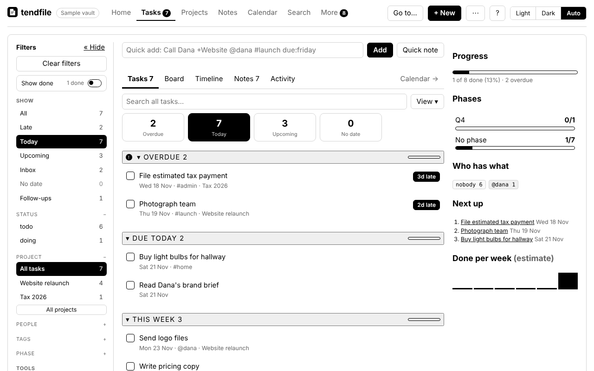
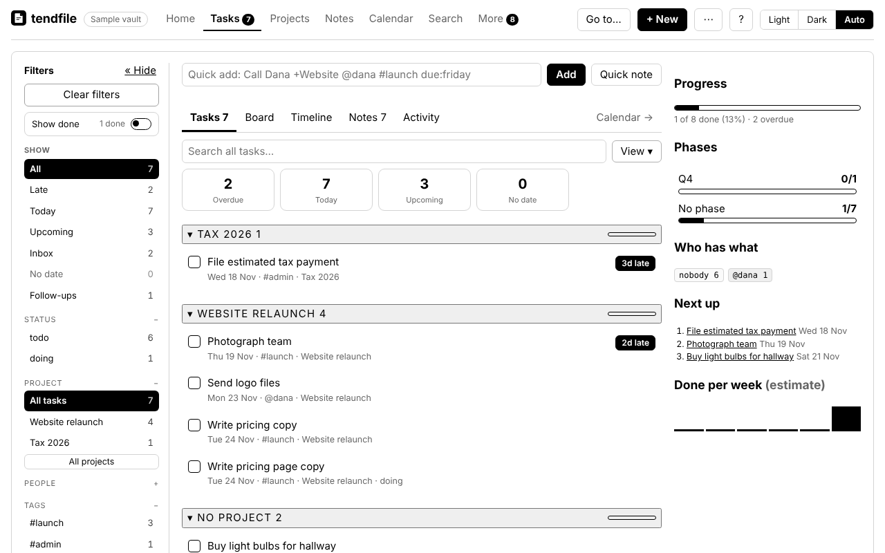
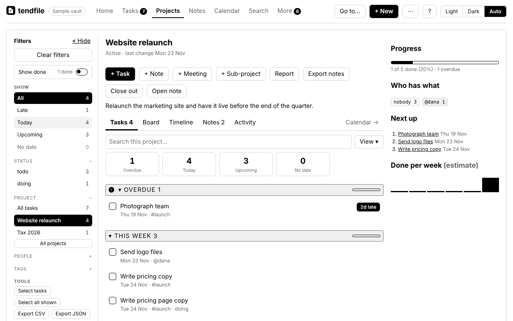
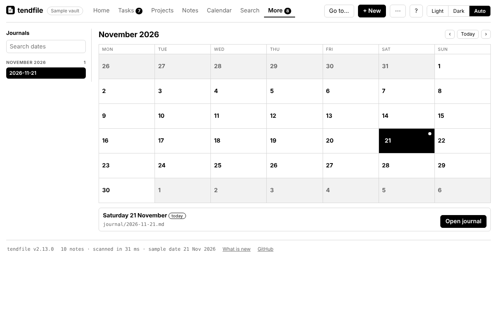
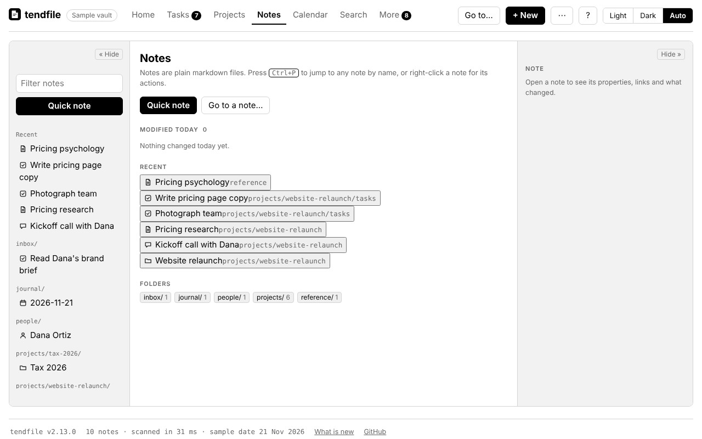
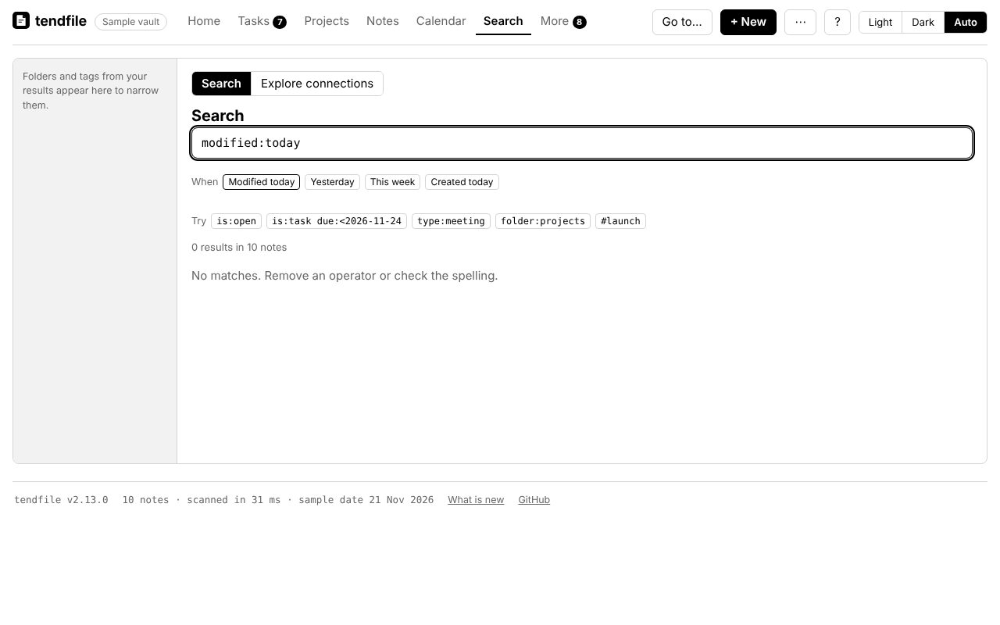
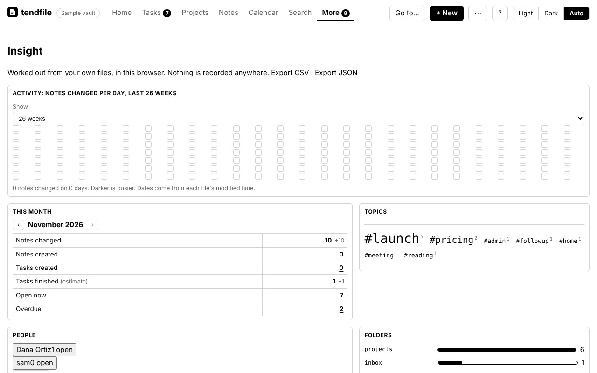
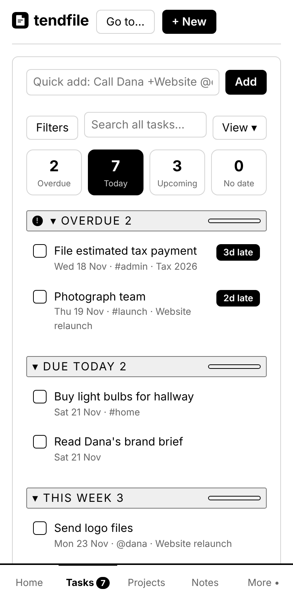
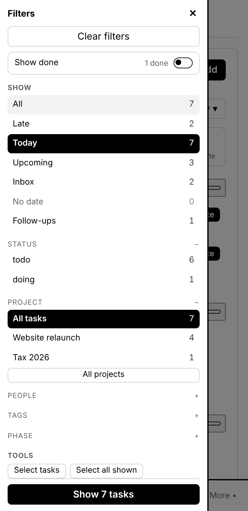
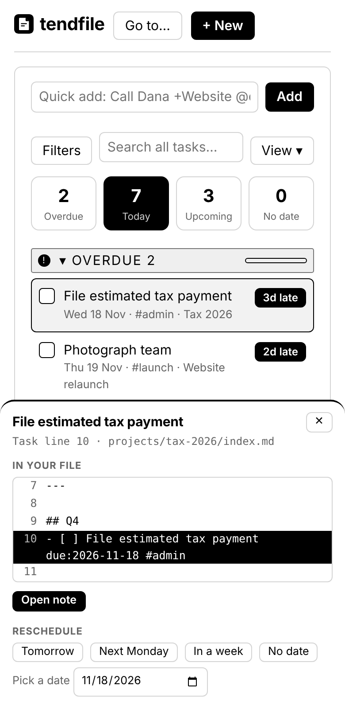

# tendfile

**tend your notes.** Formerly Plainfile; successor to Notebook. (The `.plainfile/` folder inside a vault, and the live address, keep their old names for now so nothing you have breaks.)

<a href="https://www.buymeacoffee.com/adambeltz" target="_blank" rel="noopener noreferrer"></a>

**Live app: <https://adambeltz2.github.io/Plainfile/>** (open it in Chrome, Edge or Brave to use a
local folder, or connect Dropbox in any browser, including iPhone).

A productivity hub over a plain folder of markdown files. Tasks, notes, tags and
links live in ordinary `.md` files with frontmatter. The app reads them and
gives you one place to see everything. Nothing is stored anywhere else, so the
folder is the whole repository and works with any editor or sync tool.

**The idea in one line:** your markdown files are the source of truth, and the app is a small, install-free lens on them.

## Get started

1. Open the **[live app](https://adambeltz2.github.io/Plainfile/)**. Choose **Open folder** (Chrome, Edge or Brave), **Connect Dropbox** (any browser, including iPhone), or **Try the sample vault**.
2. On **Home**, type a task in the box at the top: `Call Dana +Website @dana due:friday`. It becomes its own note.
3. Open **Tasks** to see everything across every project, **Notes** to write, and press **?** for the cheat sheet and quick keys.

New here? **[Getting started](docs/GETTING-STARTED.md)** explains what a task, a note, a journal, a meeting, a project and a person are, and walks through your first five minutes.

Your folder stays plain markdown the whole time; delete the app and every file still opens anywhere.

## How I want to work

tendfile is built around one rule: **the source of truth is plain markdown files.** Every note, task, project, tag and link is text in a `.md` file, in a folder you own. That is what makes it portable: the folder opens in any editor, syncs with anything (Dropbox, iCloud, Syncthing, git) and outlives the app. The software around it is kept as small as it can be, and there is **nothing to install**: open a web page, point it at the folder, and work.

Three tools shaped how I want to work:

- **<a href="https://github.com/todotxt/todo.txt" target="_blank" rel="noopener noreferrer">todo.txt</a>: a task is a line of text.** A priority in front, `+project` and `@context` words in the line, `due:` as a plain key and value, all readable in any text editor with no database behind it. tendfile reads and writes that style (`- [ ] (A) Call Dana +Website @dana due:friday`) and also understands Obsidian Tasks and Dataview syntax. Lists stay as short as a todo.txt list: a title and one line, with detail one tap away.
- **<a href="https://silverbullet.md/" target="_blank" rel="noopener noreferrer">SilverBullet</a>: notes are files you own, and everything else is worked out from them.** Pages are a folder of markdown, linked with `[[wikilinks]]`, edited live in the browser. Back-links, project views, counts and the index are computed from the text and never stored; the index is a cache you can delete.
- **<a href="https://nullboard.io/" target="_blank" rel="noopener noreferrer">Nullboard</a>: a board that is just a web page.** A minimal kanban you open without installing anything, with no account and no server. tendfile keeps that stance (a static page, a Board of status columns for any project) but keeps your data in your own folder, as markdown, rather than in the browser.

It also borrows from <a href="https://obsidian.md/" target="_blank" rel="noopener noreferrer">Obsidian</a> (wikilinks, a folder as the vault, reading other people's conventions). The approach differs in a few ways:

- **Tasks are their own thing, and notes can hold tasks too.** A task can be an inline `- [ ]` line or its own note with a `status:`; projects are folders, and a project can have sub-projects. Home, Tasks (opening on its Today view), the project hub and the weekly review are views over those files, not a second database.
- **Simple by default, detail on demand.** The Tasks list shows a title and one line. Filters live in one panel (docked on a wide screen, a flyout on a phone), and a task's full detail, its exact lines in the file and Reschedule are one tap away.
- **A deliberately small software stack.** TypeScript compiled into plain static files, served from a web page. There is no server, database, account or plugin system, and nothing to install or run. You can also install it as an app, and it works offline.
- **It reads other people's conventions without rewriting them.** `due:`, `📅`, Dataview `[due:: …]`, `#tags` and `[[links]]` all work, and writes touch the smallest piece of text possible.
- **It shows its work.** After every write you see the exact before and after lines; deleting goes to a trash; every save keeps history.
- **Black and white, on purpose.** State is shown with weight, borders and inversion, not color.

## What it looks like

Screenshots are of the built-in sample vault, regenerated with `npm run screenshots`.

| | |
|---|---|
| **Home**: a one-line capture bar, week bars and projects at the top, then today, filing, waiting and follow-ups |  |
| **Tasks**: opens on Today. Search and a View menu, four date counts that filter when tapped, short rows with "3d late" badges, and one filters panel on the left |  |
| **Filters**: pick a tag, person, status or project from the panel; counts say what each choice leaves, and Show done brings finished tasks back |  |
| **Group by project**: the same list, side by side by project, from the View menu |  |
| **Quick add**: `Send logos +website-relaunch @dana #launch due:friday`, with a live preview |  |
| **Project hub**: tasks grouped and filtered, sub-projects, progress, tabs and bulk changes |  |
| **Project board**: the same tasks by status columns |  |
| **Calendar**: tasks and dated notes by day, drag to reschedule |  |
| **Journal**: a month calendar with a dot on every day that has a journal, a list of dates, and one click to open (or start) a day |  |
| **Notes**: a live editor with X-ray, a properties panel, history and focus mode |  |
| **Notes home**: pinned, modified today, recent and folders |  |
| **⋯ More menu**: move, rename, duplicate, pin, delete |  |
| **Move**: a preview of the links it fixes, then Undo |  |
| **Go to…**: the command palette |  |
| **Search**: operators, plus `modified:today` and other date chips |  |
| **Explore** (a switch inside Search): related notes and a neighbourhood graph |  |
| **Insight**: activity, this month, topics, people, health |  |
| **Dark mode**: Light, Dark or Auto on every screen |  |

**On a phone** (installable, works offline): Home, then Tasks with its filters flyout, then a task's sheet.

   

## Highlights

- **One list of tasks** from inline `- [ ]` lines and one-file-per-task notes, with Tasks (opens on Today; one filters panel for date views, status, project, people and tags; short rows, detail on demand), a project hub with sub-projects (and a Board of status columns), Calendar and a weekly review.
- **A live editor** with `[[links]]`, `#tags`, `@people` and type-ahead; click a link to go there, or to create it.
- **Safe by design:** every write is the smallest edit, guarded by the file's modified time, with history, a trash, and a readout of the exact lines changed.
- **Yours:** plain files, no account or server; sync with whatever you already use. Export to Word, PDF, markdown, HTML, CSV and JSON.

## Documentation

- [Getting started](docs/GETTING-STARTED.md): what's what, and your first five minutes.
- [Features](docs/FEATURES.md): everything it does, by area.
- [Task formats](docs/TASK-FORMATS.md): the task syntaxes it reads and writes.
- [Principles and interface design](docs/DESIGN.md): what the app will not do and why.
- [Connecting Dropbox](docs/DROPBOX.md): setup for your own app key.
- [CONTRIBUTING.md](CONTRIBUTING.md), [CHANGELOG.md](CHANGELOG.md), [BACKLOG.md](BACKLOG.md), and `CLAUDE.md` for the engineering conventions.

## Develop and run it locally

```bash
npm install
npm run build && npm run serve   # then open http://127.0.0.1:4173
npm test                         # unit tests
npm run test:e2e                 # browser tests, including a real folder
npm run screenshots              # regenerate docs/screenshots (needs the server running)
npm run plainfile -- today --vault sample-vault --today 2026-11-21
npm run plainfile -- check --vault sample-vault
npm run plainfile -- check --json --strict --vault sample-vault   # for CI: JSON report, exit 1 if a link is broken
npm run plainfile -- search "is:open tag:launch" --vault sample-vault
```

Commands: `today`, `tasks`, `search`, `backlinks`, `check`, `scan`, `done`, `undo`.
Task ids are `path:line`, as printed by `today` and `tasks`.

## License

MIT. See `LICENSE`.
